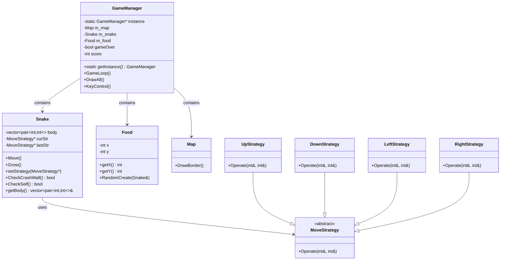
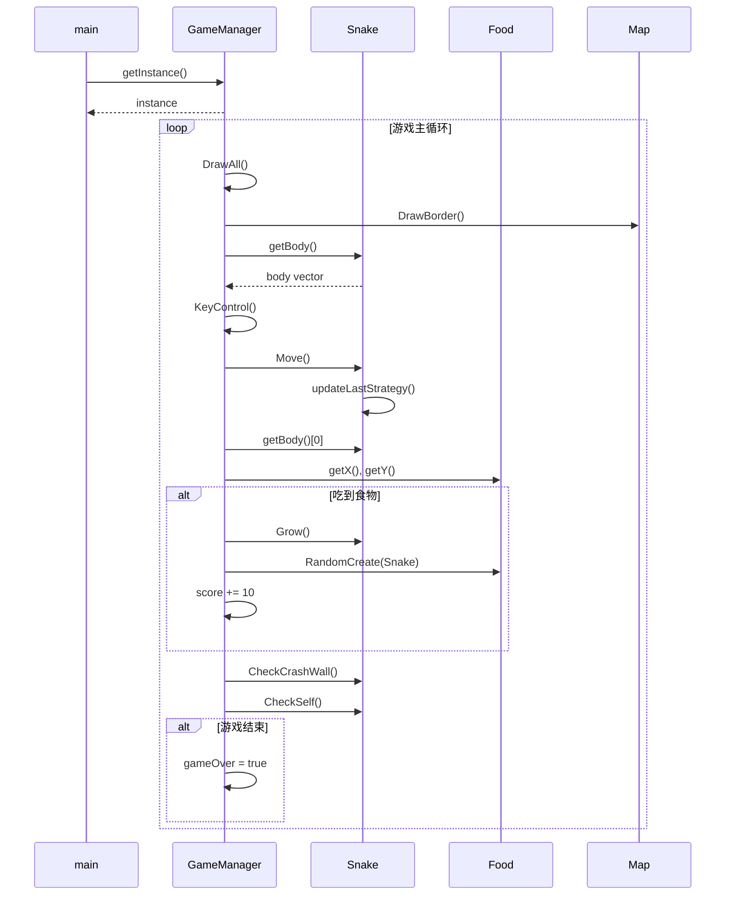

# 贪吃蛇游戏实验报告

## 一、实验概述

本实验实现了一个基于策略模式和单例模式的贪吃蛇游戏。通过设计模式的应用，使代码具有良好的可扩展性和可维护性。

---

## 二、UML 设计图

### 2.1 类图



### 2.2 游戏流程时序图



---

## 三、工程文件结构设计

### 3.1 文件组织结构

```
贪吃蛇2/
├── main.cpp          # 程序入口，调用游戏管理器
├── GameManager.h/cpp # 游戏管理器（单例模式）
├── Snake.h/cpp       # 蛇类（策略模式使用者）
├── Food.h/cpp        # 食物类
├── Map.h/cpp         # 地图类
├── MoveStrategy.h/cpp # 移动策略接口及实现
└── build.bat         # 编译脚本
```

### 3.2 文件职责说明

| 文件 | 职责 | 设计模式 |
|------|------|----------|
| `main.cpp` | 程序入口，获取单例并启动游戏 | - |
| `GameManager.h/cpp` | 游戏主控，管理游戏循环、绘制、输入 | **单例模式** |
| `Snake.h/cpp` | 蛇的行为控制，包含移动策略 | **策略模式使用者** |
| `Food.h/cpp` | 食物生成与位置管理 | - |
| `Map.h/cpp` | 地图边界绘制 | - |
| `MoveStrategy.h/cpp` | 移动策略接口及四个方向实现 | **策略模式** |

---

## 四、单例模式分析

### 4.1 设计意图

**单例模式**确保 `GameManager` 类在整个应用中只有一个实例，提供全局访问点，避免多个游戏实例导致状态混乱。

### 4.2 关键代码

**GameManager.h**（头文件声明）：

```cpp
class GameManager{
private:
    static GameManager* instance;  // 静态实例指针
    GameManager();                 // 私有构造函数
    GameManager(const GameManager&)=delete;  // 禁止拷贝构造

public:
    static GameManager* getInstance();  // 静态获取方法
    void GameLoop();
    void DrawAll();
    void KeyControl();
};
```

**GameManager.cpp**（实现）：

```cpp
GameManager* GameManager::instance=nullptr;

GameManager* GameManager::getInstance(){
    if(!instance) instance=new GameManager();
    return instance;
}
```

### 4.3 设计要点分析

| 要点 | 实现方式 | 目的 |
|------|----------|------|
| **私有构造** | `GameManager()` 设为 private | 禁止外部直接创建对象 |
| **禁止拷贝** | `=delete` 删除拷贝构造 | 防止通过拷贝创建新实例 |
| **静态指针** | `static GameManager* instance` | 存储唯一实例 |
| **静态方法** | `static getInstance()` | 提供全局访问入口 |

---

## 五、策略模式分析

### 5.1 设计意图

**策略模式**将蛇的移动行为封装为独立的策略对象，使得移动算法可以独立于使用它的 `Snake` 类变化，实现开闭原则。

### 5.2 关键代码

**MoveStrategy.h**（策略接口）：

```cpp
class MoveStrategy {
public:
    virtual ~MoveStrategy()=default;
    virtual void Operate(int& headX, int& headY)=0;  // 纯虚函数
};

class UpStrategy:public MoveStrategy{
public:
    void Operate(int& x, int& y)override;
};

class DownStrategy:public MoveStrategy{
public:
    void Operate(int& x, int& y)override;
};

class LeftStrategy:public MoveStrategy{
public:
    void Operate(int& x, int& y)override;
};

class RightStrategy:public MoveStrategy{
public:
    void Operate(int& x, int& y)override;
};
```

**MoveStrategy.cpp**（策略实现）：

```cpp
void UpStrategy::Operate(int &x, int &y){y--;}
void DownStrategy::Operate(int &x, int &y){y++;}
void LeftStrategy::Operate(int &x, int &y){x--;}
void RightStrategy::Operate(int &x, int &y){x++;}
```

**Snake.cpp**（策略使用者）：

```cpp
void Snake::Move(){
    for(int i=body.size()-1;i>0;i--) body[i]=body[i-1];
    curStr->Operate(body[0].first, body[0].second);  // 委托给策略对象
    updateLastStrategy();
}
```

### 5.3 设计要点分析

| 要点 | 实现方式 | 目的 |
|------|----------|------|
| **抽象接口** | `MoveStrategy` 基类 | 定义策略统一接口 |
| **具体策略** | 四个方向策略类 | 封装具体移动算法 |
| **策略切换** | `setStrategy()` 方法 | 动态改变行为 |
| **依赖倒置** | 依赖抽象而非具体 | 符合开闭原则 |

---

## 六、运行效果

### 6.1 游戏界面说明

游戏运行时显示：
- **边框**：`#` 字符表示边界
- **蛇头**：`●` 表示蛇的头部
- **蛇身**：`□` 表示蛇的身体
- **食物**：`O` 表示食物
- **状态栏**：显示分数和操作提示

### 6.2 操作说明

| 按键 | 功能 |
|------|------|
| `W` | 向上移动 |
| `S` | 向下移动 |
| `A` | 向左移动 |
| `D` | 向右移动 |
| `ESC` | 退出游戏 |

### 6.3 游戏规则

1. 蛇自动向前移动，玩家通过方向键控制移动方向
2. 蛇不能180度掉头（如向上时不能直接向下）
3. 吃到食物（O）后蛇身增长，分数+10
4. 撞到墙壁或自己身体时游戏结束

---

## 七、代码优化与改进

### 7.1 已修复的问题

| 问题类型 | 问题描述 | 修复方案 |
|----------|----------|----------|
| **内存泄漏** | 策略对象未释放 | 析构函数中 delete |
| **逻辑漏洞** | 允许180度掉头 | 添加 lastStr 记录并检查 |
| **用户体验** | 蛇头蛇身难以区分 | 蛇头显示 `●`，蛇身显示 `□` |
| **文件错误** | 存在错误命名文件 | 删除 `Snake,h.cpp` |

### 7.2 后续改进建议

1. **线程安全**：单例模式的 `getInstance()` 可添加互斥锁
2. **策略缓存**：使用静态策略对象避免频繁 new/delete
3. **音效系统**：添加吃食物和游戏结束音效
4. **关卡系统**：随着分数增加提高游戏速度

---

## 八、总结

本实验成功实现了贪吃蛇游戏，通过**单例模式**确保游戏管理器的唯一性，通过**策略模式**实现蛇的移动行为的灵活切换。代码结构清晰，符合面向对象设计原则，具备良好的可扩展性和可维护性。
